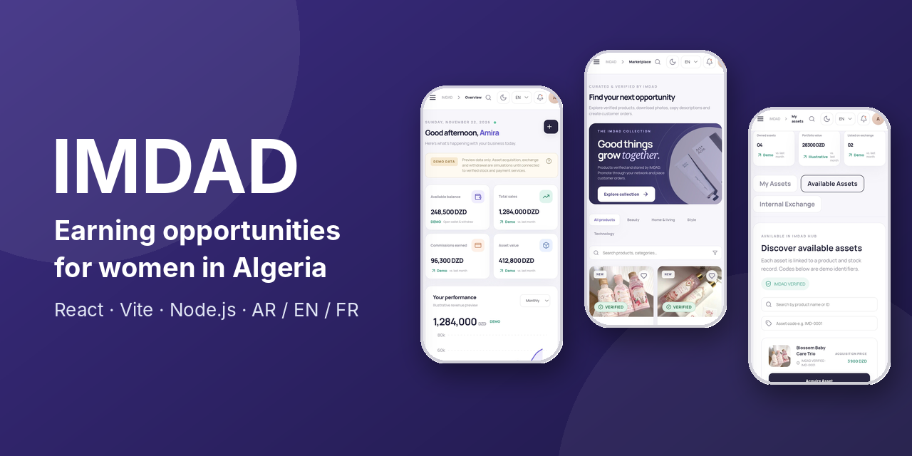
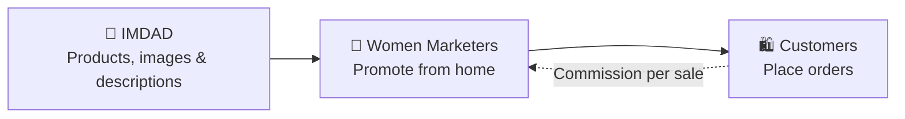

  

<h1 align="center">IMDAD · إمداد</h1>

  <strong>Building opportunities. Empowering women through technology.</strong>

IMDAD is an Algerian entrepreneurial project founded by **Asma Bouchaala**. It aims to help women create income opportunities from home without requiring upfront capital or prior commercial experience.

🌐 **[Live Demo](https://imdad-e2yr.onrender.com/)**  
📐 **[Project Architecture](PROJECT-ARCHITECTURE.md)**

> ⚠️ **Prototype Notice**
>
> IMDAD is currently a working prototype. The frontend operates in demo mode using browser Local Storage. Balances, orders, commissions, assets, and withdrawals are demonstrations only.

---

## The Problem

Many women want financial independence but face barriers that make starting a business difficult:

- Limited or no starting capital.
- Restricted access to suppliers and products.
- Little experience in sales and marketing.
- Social and geographic limitations on mobility.
- Difficulty accessing flexible income opportunities.

IMDAD explores a technology-driven way to reduce these barriers.

## How IMDAD Works

IMDAD connects three parties:

1. **IMDAD:** Sources products and prepares professional product images and descriptions.
2. **Women Marketers:** Promote products to their own networks from home.
3. **Customers:** Discover and order products through marketers.

Marketers earn a commission for each successful sale without purchasing inventory in advance.

An optional second journey allows members to acquire stock-linked digital assets.

---

## Features

The prototype includes:

### Marketplace
- Product catalog and product details.
- Product verification demonstration badge.
- Copyable product descriptions.
- Downloadable product images.
- Product-specific options.
- Customer order form.

### Assets
- My Assets.
- Available Assets.
- Internal Exchange demonstration.
- Demo listing and transfer interfaces.

### Dashboard & Wallet
- Overview dashboard.
- Orders and commissions.
- Pending and available balance views.
- Withdrawal history demonstration.

### Community
- Community Galaxy.
- Member activity and community statistics.

### User Experience
- Arabic, English, and French support.
- Full right-to-left (RTL) layout.
- Light and dark themes.
- Responsive interface.

### Technical Foundation
- PostgreSQL schema foundation for:
  - Stock.
  - Physical assets.
  - Transfers.
  - Exchange listings.
  - Wallets.
  - Transactions.
  - Withdrawals.
  - Referral attribution.

---

## Tech Stack

| Technology | Purpose |
|---|---|
| React | Frontend |
| Vite | Development and build tooling |
| Node.js | Backend foundation |
| PostgreSQL | Database schema |
| Render | Deployment |

---

## Live Demo

The application is deployed on **Render**.

🌐 **[Open IMDAD](https://imdad-e2yr.onrender.com/)**

The live application currently operates in prototype demo mode.

---

## Prototype Boundary

Transparency is important when presenting the current state of IMDAD.

The frontend currently uses browser Local Storage and is not connected to the backend API or PostgreSQL database.

The following features are demonstrations only:

- Product verification badges and stock codes.
- Asset acquisitions and exchange transfers.
- Orders and commissions.
- Wallet balances and withdrawals.

No real goods are reserved, no legal ownership is transferred, and no funds are received or paid through the prototype.

The displayed 15% resale discount is illustrative and does not guarantee liquidity or resale.

Product images currently use remote demonstration URLs and must be replaced with owned or properly licensed supplier images before commercial deployment.

### Before a Real-World Launch

The following work remains necessary:

- Authenticated APIs and role-based access controls.
- Transactional stock reservations.
- Commission settlement after delivery and return windows.
- An idempotent wallet ledger.
- Verified warehouse workflows.
- Payment and payout provider integration.
- Audit trails.
- Data protection and security review.
- Legal and accounting review.

---

## Roadmap

- [ ] Connect the frontend to the backend API and PostgreSQL.
- [ ] Implement authentication and role-based access.
- [ ] Build a real product verification workflow.
- [ ] Integrate payment and payout systems.
- [ ] Develop the AI-powered product discovery assistant.
- [ ] Expand the platform's community features.

---

## بالعربية

**إمداد** مشروع ريادي جزائري أسّسته أسماء بوشعالة، يهدف إلى خلق فرص دخل للنساء من المنزل دون الحاجة إلى رأس مال مسبق أو خبرة تجارية.

تقوم الفكرة على ربط ثلاث جهات:

- **إمداد:** توفّر المنتجات والصور والأوصاف الاحترافية.
- **المسوّقات:** يروّجن المنتجات عبر شبكاتهن الخاصة من المنزل.
- **العملاء:** يطلبون المنتجات من خلال المسوّقات.

تحصل المسوّقة على عمولة مقابل كل عملية بيع ناجحة، دون الحاجة إلى شراء المخزون مسبقًا.

يضم النموذج الأولي واجهة متعددة اللغات، وسوقًا للمنتجات، ونظامًا تجريبيًا للأصول والمحفظة والطلبات والعمولات، بالإضافة إلى مساحة مجتمعية.

المشروع حاليًا في مرحلة النموذج الأولي، والأرصدة والطلبات والعمولات وعمليات السحب المعروضة داخل التطبيق تجريبية وليست معاملات مالية حقيقية.

---

## About the Founder

**Asma Bouchaala**  
Founder & Developer of IMDAD

I enjoy turning real-world problems into practical digital solutions.

IMDAD started with a simple question:

*What if women could access business opportunities without needing the resources that usually prevent them from starting?*

I am building IMDAD to explore that possibility through technology, entrepreneurship, and accessible digital tools.

---

*Built with purpose by Asma Bouchaala.*
